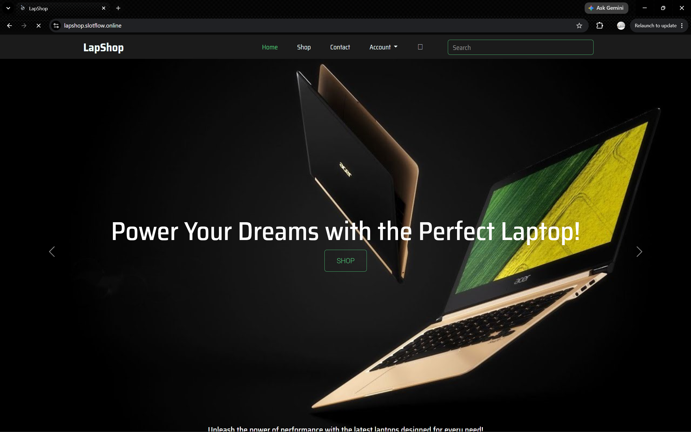
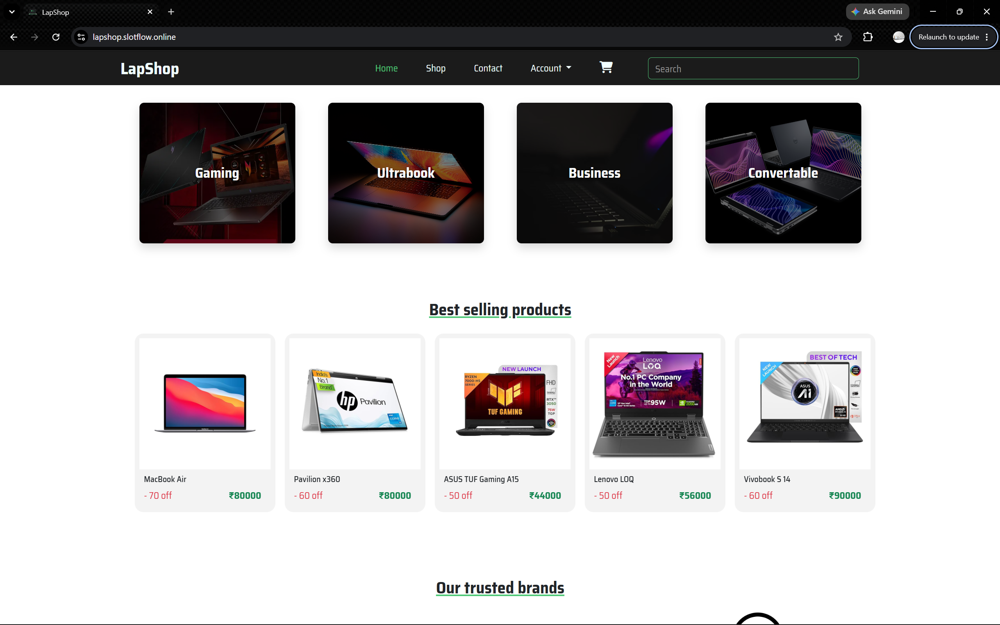

# 💻 LapShop — Laptop E-Commerce Platform

**A full-stack, server-rendered e-commerce application built with Node.js, Express, EJS, and MongoDB.**

A unified Express application that serves both the backend business logic and the EJS-rendered frontend, following the **Model–View–Controller (MVC)** architecture.

---

## Project Overview 📋

LapShop is a fully functional e-commerce web application dedicated to laptops. It includes separate **customer-facing** and **administrative** interfaces within a single, server-rendered Node.js application. Express handles routing, middleware, and business logic, while **EJS templates render the user interface on the server**. The codebase follows the **MVC pattern** and uses middleware for authentication and security.

The project also covers deployment and infrastructure practices, including **AWS EC2**, **Amazon ECS**, **Nginx** as a reverse proxy, and **SSL/TLS certificates** for secure connections and uploads.

## Technology Stack ⚙️

| Layer | Technologies |
| --- | --- |
| Frontend / Views | HTML, CSS, Bootstrap, EJS |
| Backend | Node.js, Express.js (CommonJS) |
| Database | MongoDB, Mongoose |
| Authentication & Sessions | bcrypt, express-session, cookie-parser |
| File Uploads | Multer |
| Email | Nodemailer |
| Invoice Generation | PDFKit |
| Payments | Razorpay |
| Code Quality | ESLint, Prettier |
| Deployment | AWS EC2, Amazon ECS, Nginx, SSL/TLS |

## Screenshots 📸

**LapShop home page**

**LapShop admin dashboard**

## Features 🌟

### Customer Features 👤

**Authentication and account management**
- Sign up with email verification.
- Log in, recover a forgotten password, and change a password with email verification.
- Manage profile information, profile images, and saved addresses.

**Product discovery and shopping**
- View product details with image zoom, specifications, popular products, related products, and reviews.
- Filter products by brand and category; sort by name.
- Search with debouncing.
- Manage a shopping cart with **Save for Later** functionality.
- Save products to a wishlist.
- Manage checkout addresses directly from the checkout page.

**Payments, wallet, and promotions**
- Pay using Razorpay, Cash on Delivery (COD), or wallet balance.
- Combine wallet balance with an online Razorpay payment.
- View wallet credit and debit transaction history.
- Apply coupons during checkout.

**Orders and engagement**
- View purchase confirmations and order details.
- Receive purchase-related email notifications.
- Track orders and request returns or cancellations.
- Download PDF invoices.
- Review purchased products.
- View dynamic promotional banners and use the contact page.
- Access a responsive interface across device sizes.

### Administrator Features 🧑‍💼

- **Product management:** Add, edit, and delete products with multiple images.
- **Catalog management:** Manage laptop brands and categories.
- **Coupon management:** Create and manage promotional coupons.
- **Banner management:** Manage dynamic homepage advertisements.
- **Order management:** Inspect orders and update their statuses.
- **User management:** Block or unblock user accounts.
- **Analytics dashboard:** Review key data using multiple charts and graphs, including top-performing products, categories, and brands.
- **Reporting:** Filter order data by day, month, or year; print reports and export order data to Excel.

## Key Libraries 🛠️

| Library | Role |
| --- | --- |
| `bcrypt` | Password hashing |
| Node.js `crypto` | Random-string generation |
| `multer` | Image upload handling |
| `mongoose` | MongoDB models and data operations |
| `nodemailer` | Transactional email notifications |
| `pdfkit` | PDF invoice generation |
| SweetAlert | User-facing alerts and confirmations |
| `razorpay` | Online payment integration |

## Project Background

LapShop was developed from scratch as a full-stack learning and engineering project. Its implementation spans frontend rendering, backend development, authentication, catalog and order management, payments, administrative reporting, and cloud deployment. The application has evolved through iterative feature development, optimization.

## License 📄

This project is licensed under the **ISC License**. See the [LICENSE](./LICENSE) file for details.
