# 📸 LapShop — Application Screenshots

**Explore the LapShop e-commerce platform through its application screenshots.**

---

<table>
  <tr>
    <td width="50%" align="center">
      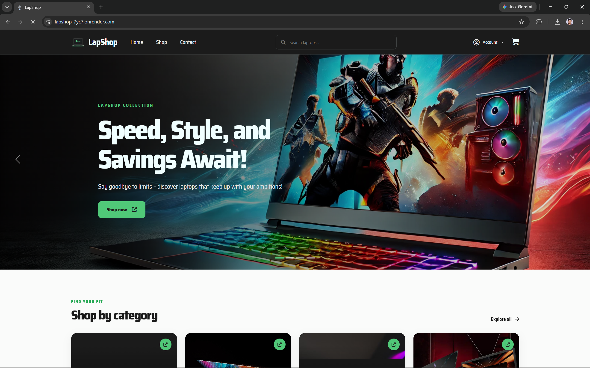
      <b>Screenshot 01</b>
    </td>
    <td width="50%" align="center">
      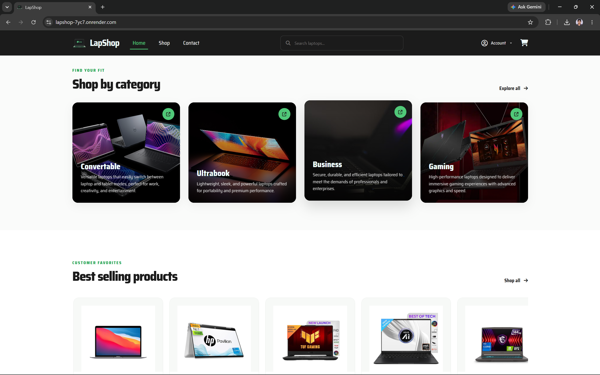
      <b>Screenshot 02</b>
    </td>
  </tr>
  <tr>
    <td width="50%" align="center">
      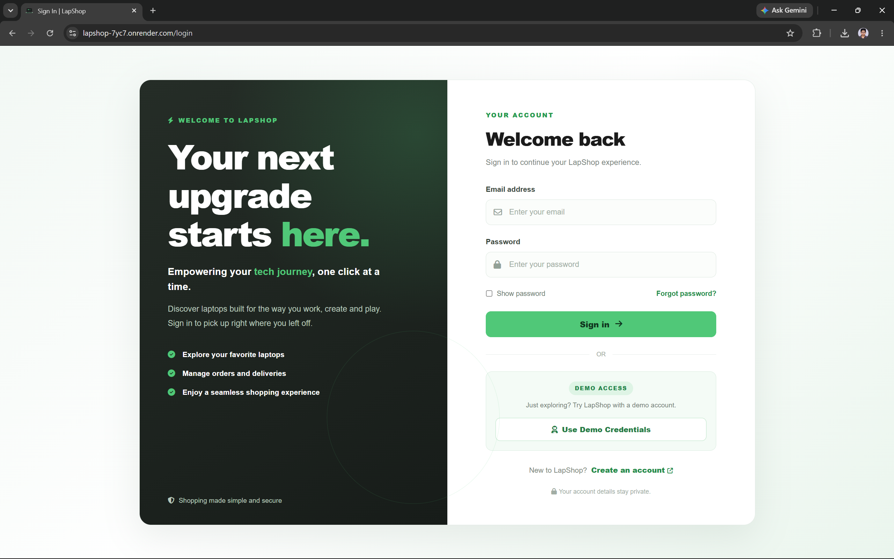
      <b>Screenshot 03</b>
    </td>
    <td width="50%" align="center">
      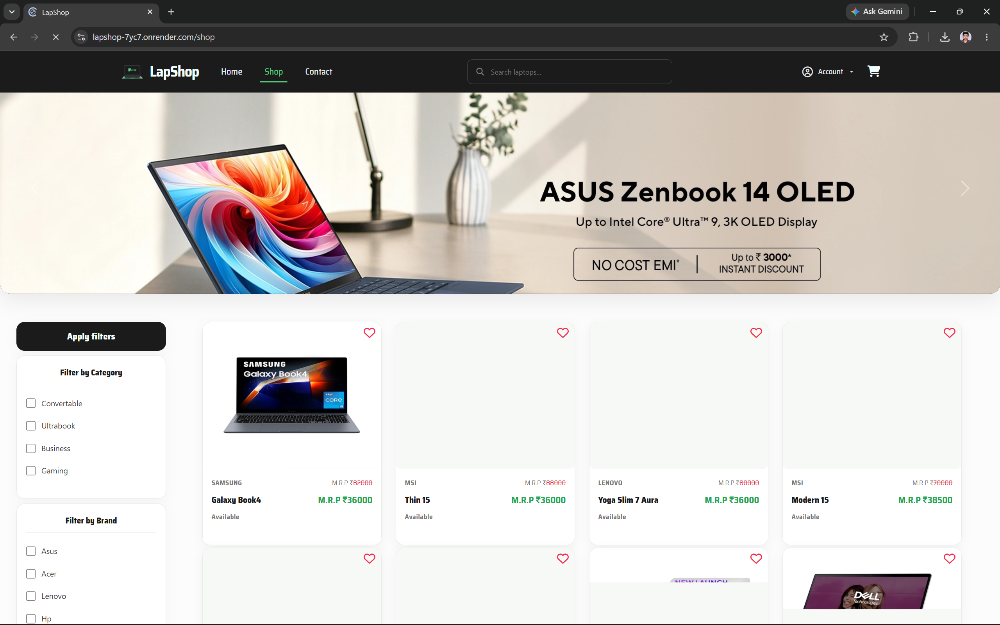
      <b>Screenshot 04</b>
    </td>
  </tr>
  <tr>
    <td width="50%" align="center">
      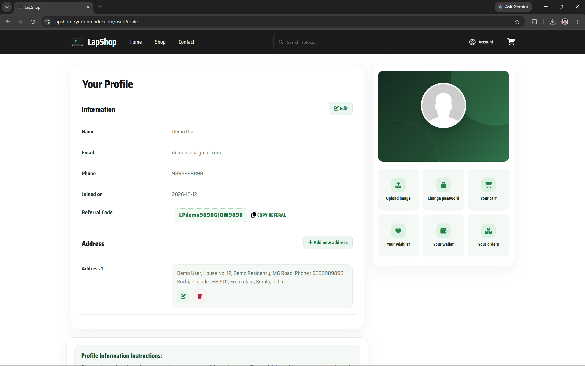
      <b>Screenshot 05</b>
    </td>
    <td width="50%" align="center">
      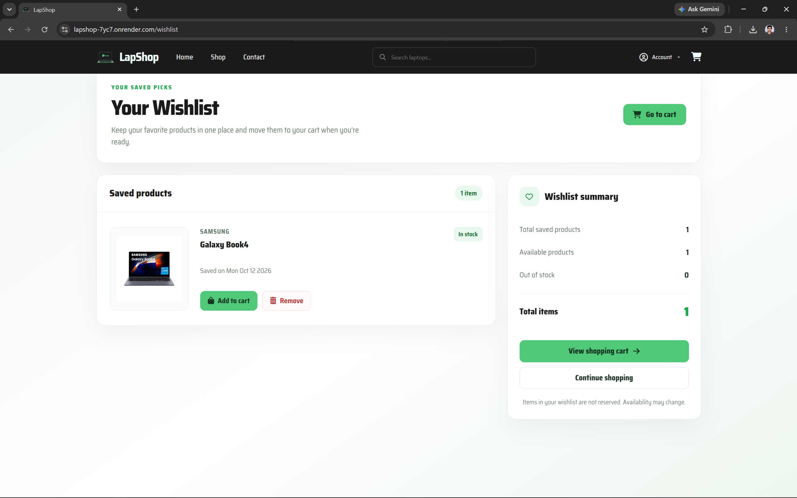
      <b>Screenshot 06</b>
    </td>
  </tr>
  <tr>
    <td width="50%" align="center">
      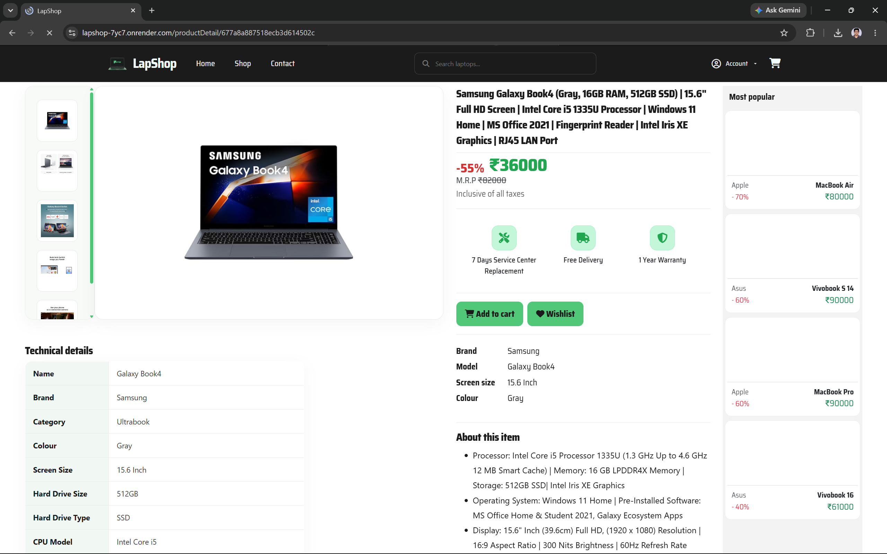
      <b>Screenshot 07</b>
    </td>
    <td width="50%" align="center">
      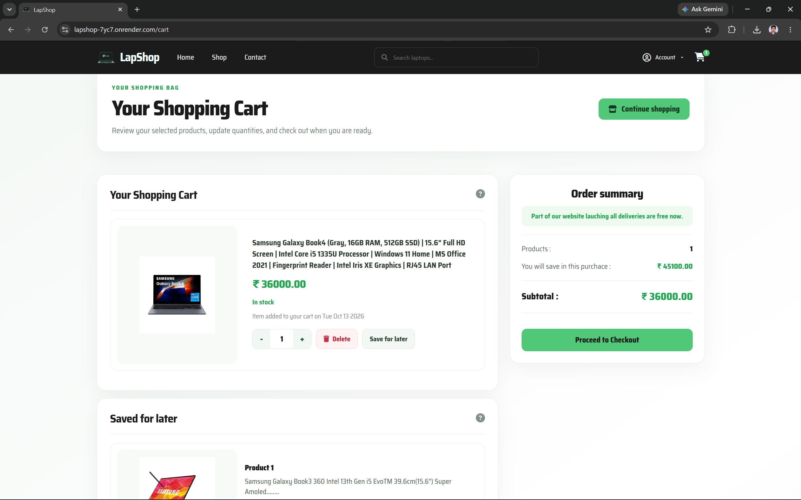
      <b>Screenshot 08</b>
    </td>
  </tr>
  <tr>
    <td width="50%" align="center">
      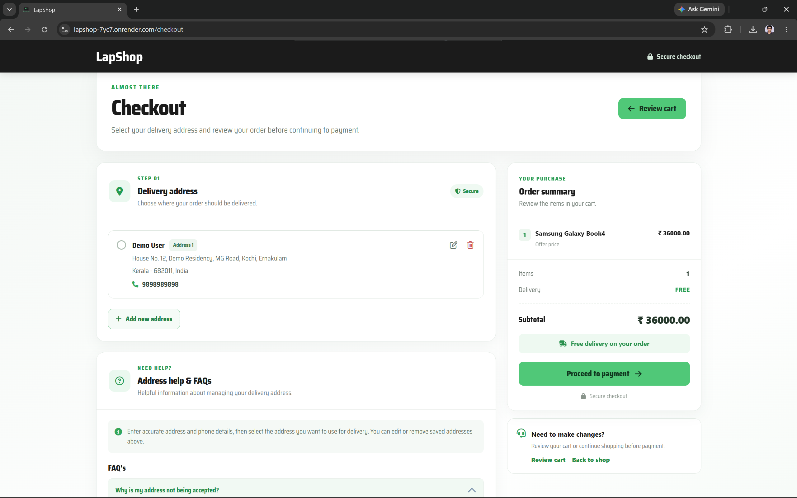
      <b>Screenshot 09</b>
    </td>
    <td width="50%" align="center">
      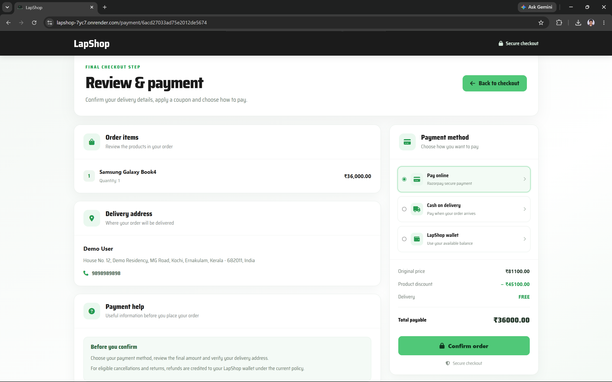
      <b>Screenshot 10</b>
    </td>
  </tr>
  <tr>
    <td width="50%" align="center">
      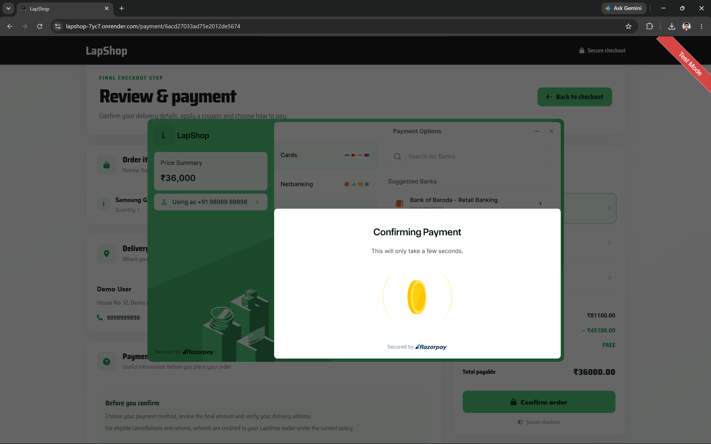
      <b>Screenshot 11</b>
    </td>
    <td width="50%" align="center">
      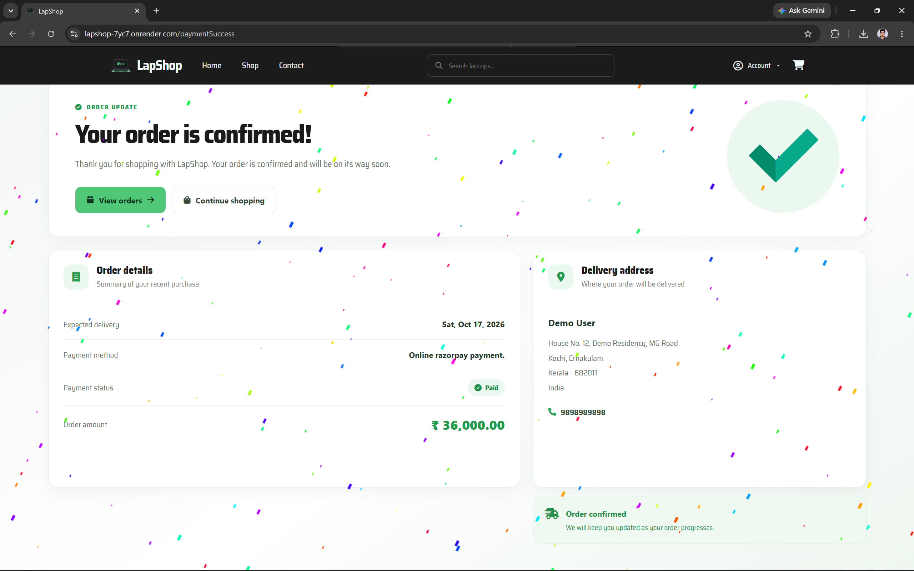
      <b>Screenshot 12</b>
    </td>
  </tr>
  <tr>
    <td width="50%" align="center">
      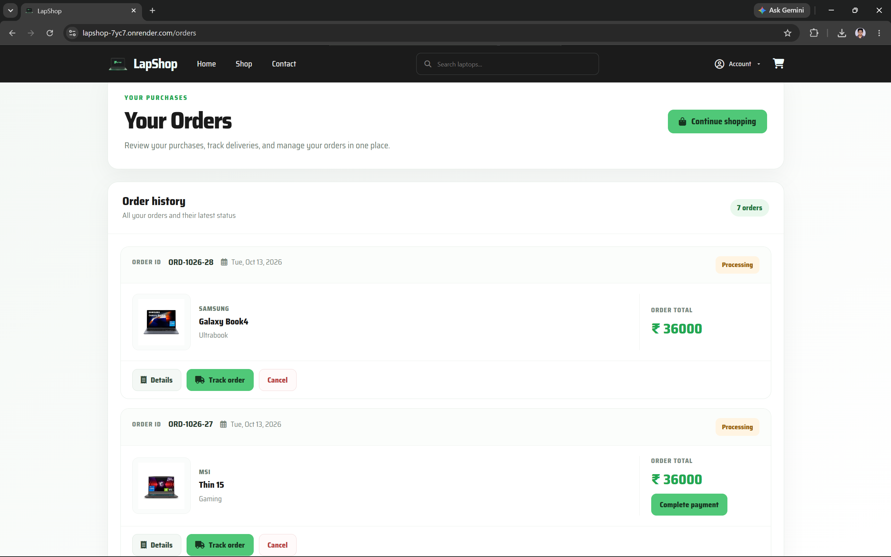
      <b>Screenshot 13</b>
    </td>
    <td width="50%" align="center">
      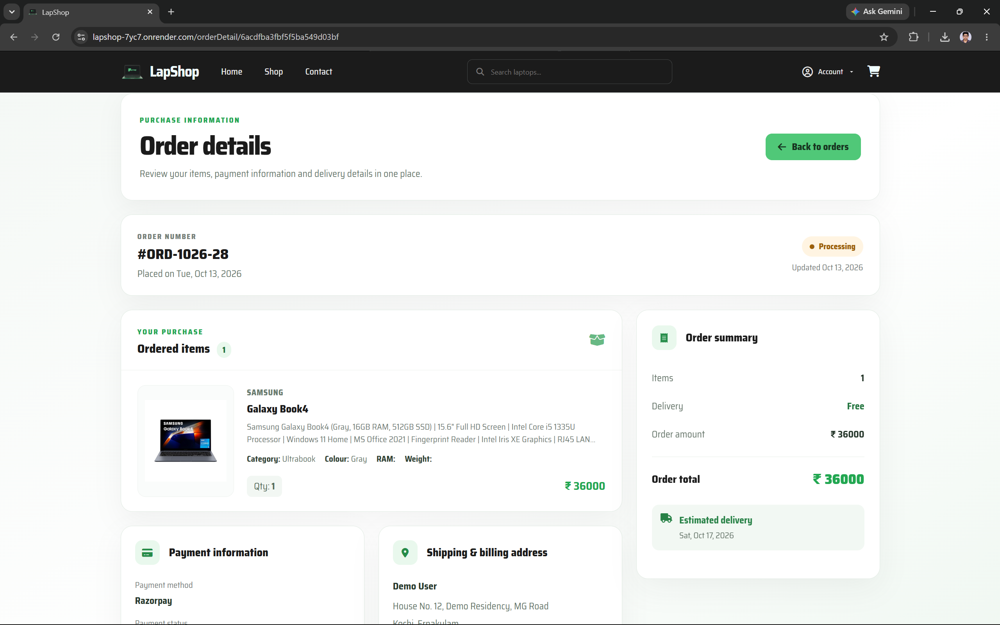
      <b>Screenshot 14</b>
    </td>
  </tr>
  <tr>
    <td width="50%" align="center">
      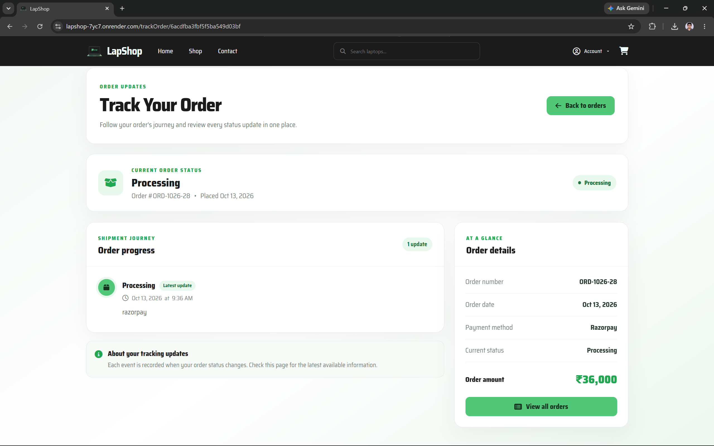
      <b>Screenshot 15</b>
    </td>
    <td width="50%" align="center">
      <b>Explore LapShop Live</b>
      
Experience the application directly.

      <a href="https://lapshop.midhunkpaniker.online">Visit LapShop →</a>
    </td>
  </tr>
</table>

---

[← Back to README](./README.md) · [🌐 Visit LapShop](https://lapshop.midhunkpaniker.online)

